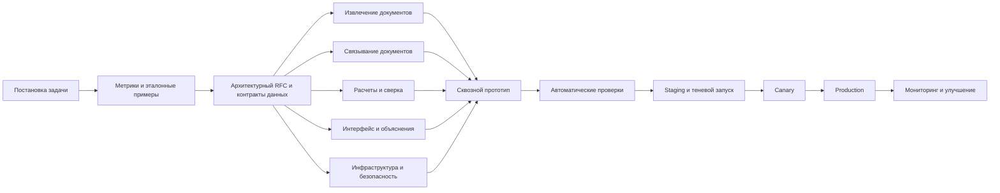

# План разработки системы проверки финансовой отчетности

## Назначение документа

Этот документ описывает организацию разработки системы, которая сверяет итоговый финансовый отчет с первичными документами. План охватывает путь от постановки задачи и формирования эталонного набора данных до безопасного вывода решения в промышленную эксплуатацию.

Главный принцип разработки: двигаться короткими сквозными итерациями от входного документа до проверяемого результата, одновременно развивая независимые технические направления на основе общих контрактов данных.

Подробный разбор предоставленного набора данных находится в документе [Разбор набора данных для кейса 19](dataset-case-19-audit.md).

Решения и критерии текущего исследовательского этапа зафиксированы в документе [Этап исследования и выбора решения](research-and-poc-stage.md).

Целевая архитектура с учетом официальной разбалловки жюри описана в документе [Архитектура решения с учетом критериев жюри](jury-aligned-architecture.md).

Метрики качества и правила приемки вынесены в документ [Метрики оценки решения](evaluation-metrics.md). Усредненная дельта между суммами не используется как метрика качества.

Результаты нормализации, классификации и финансовой сверки зафиксированы в документе [Классификация операций и сверка с КФЗ](operation-reconciliation-results.md).

Спецификация ближайшего технического эксперимента находится в документе [PoC распознавания целевой строки КФЗ](kfz-row-extraction-poc.md).

Выбор переносимого OCR, Docker-конфигурация и результаты Linux-бенчмарка описаны в документе [Linux OCR и Docker: решение и результаты](linux-ocr-docker-results.md).

## Текущее состояние

- Набор кейса 19 проинвентаризирован и независимо проверен.
- Зафиксирован эталонный финансовый результат и тестовая матрица.
- По результатам исследования выбран гибридный подход: нативный разбор офисных файлов, OCR/VLM только для сканов, LLM для смысловой классификации и детерминированные финансовые расчеты.
- Архитектура дополнена самостоятельными контурами развертывания, демонстрации, трассируемости, изоляции технических ошибок и локальной обработки данных.
- Предобучение с нуля и дообучение модели не входят в текущий этап.
- Сравнительный локальный PoC экстрактора КФЗ выполнен; `VerificationContext` и обработка первичных документов подключены.
- Ближайший PoC ограничен распознаванием строки `3 этап, 2026 г.` из итоговой КФЗ и имеет жесткий критерий точного совпадения всех критических ячеек.
- Локальный OCR-baseline КФЗ завершен: 300, 400 и 600 DPI, по три повтора; full-page и region-first режимы дали 15 из 15 точных значений во всех прогонах.
- Linux OCR-контур реализован и подключен к сверке: PaddleOCR region-first 300 DPI — основной, Tesseract full-page 400 DPI — fallback; оба прошли 15/15 в 3/3 повторах.
- Docker-образ содержит модели и не требует сети во время обработки; production pipeline не читает evaluation gold.
- Реестр первичных документов реализован: нативный DOCX/XLSX, локальный OCR PDF/PNG, SHA-256, oracle isolation, фильтры дублей, договора и периода. Результаты описаны в документе [Реестр и фильтрация документов](document-registry-results.md).
- Реализован реестр операций: 19 документов классифицированы по содержанию в `0200/0300/0800/0900`, суммы агрегированы через `Decimal`, а результаты связаны с доказательствами.
- Сверка подтвердила `0200`, `0300`, `0900`, выявила завышение `0800` и общего итога на 12 500,00 руб. и сформировала заключение `REPORT_UNRELIABLE`.

## Общий процесс



## Роли и ответственность

В небольшой команде один человек может совмещать несколько ролей, но у каждого результата должен быть один ответственный — DRI.

| Роль | Ответственность |
|---|---|
| Product owner | Пользовательский результат, границы задачи и приоритеты |
| Tech lead | Архитектура, контракты, интеграция и технические решения |
| Data или ML engineer | OCR, извлечение значений и сопоставление документов |
| Backend engineer | Расчеты, правила, API и хранение данных |
| Frontend или product engineer | Интерфейс проверки, объяснения и работа с источниками |
| QA или evaluation engineer | Эталонный набор, метрики качества и регрессионные проверки |
| DevOps и security | Контейнеризация, развертывание, мониторинг и защита данных |

## Продуктовый контракт

### Основной пользовательский сценарий

1. Пользователь загружает итоговый отчет и первичные документы.
2. Система проверяет и обрабатывает каждый файл.
3. Строки отчета связываются с подходящими источниками.
4. Система рассчитывает ожидаемые значения.
5. Пользователь получает статус каждой строки и подтверждающие фрагменты.
6. Неоднозначные случаи направляются на ручную проверку.
7. Система формирует общее заключение о достоверности отчета.

### Статусы проверки

- Корректно.
- Обнаружено расхождение.
- Недостаточно данных.
- Неоднозначная связь.
- Документ продублирован.
- Неверный период или договор.
- Техническая ошибка обработки.

Недостаток данных или неоднозначная связь не должны автоматически считаться финансовым расхождением.

### Метрики качества

- точность извлечения реквизитов и значений;
- точность связывания документов;
- точность обнаружения расхождений;
- доля корректных строк, ошибочно помеченных проблемными;
- доля результатов с проверяемым источником;
- доля строк, которые система смогла проверить;
- количество технически необработанных файлов;
- время обработки комплекта документов.

## Общие сущности и контракты данных

Параллельные направления разработки должны заранее согласовать следующие сущности:

| Сущность | Содержание |
|---|---|
| Document | Файл, формат, тип, договор, период, номер и хеш |
| ExtractedField | Извлеченное значение, тип данных и уверенность |
| EvidenceReference | Страница, область изображения, ячейка или абзац источника |
| ReportMetric | Проверяемая строка или показатель итогового отчета |
| LinkCandidate | Возможная связь показателя с первичным документом |
| Calculation | Формула, входные значения, единицы и правила округления |
| VerificationResult | Статус, фактическое и ожидаемое значение, размер расхождения |
| Issue | Категория несоответствия и понятное пользователю объяснение |

Для каждого итогового значения должна сохраняться воспроизводимая цепочка его происхождения.

## Параллельные направления разработки

| Направление | Результат | Основной подход | Резервный подход |
|---|---|---|---|
| Прием файлов | Проверенные и зарегистрированные входные документы | Проверка формата, хеши и поиск точных дублей | Изолированная очередь необработанных файлов |
| Извлечение | Текст, таблицы, суммы и реквизиты | Нативные парсеры PDF, DOCX и XLSX | Локальный OCR для сканов и изображений |
| Нормализация | Единый формат дат, сумм и единиц | Детерминированные правила | Контекстная обработка сложных случаев |
| Связывание | Связи строк отчета с источниками | Договор, период, номер и другие точные признаки | Нечеткое и семантическое сопоставление |
| Расчеты | Ожидаемые значения и история вычислений | Явные правила и агрегирование | Настраиваемые шаблоны расчетов |
| Поиск расхождений | Статусы и категории проблем | Типизированные детерминированные проверки | Классификация нестандартных случаев |
| Доказательства | Проверяемые ссылки на источник | Страница, координаты, ячейка или абзац | Текстовый фрагмент с окружающим контекстом |
| Интерфейс | Понятный результат сверки | Таблица проверок и просмотр источника | Экспортируемый итоговый отчет |
| Evaluation | Независимая оценка качества | Размеченный эталонный набор | Синтетические и намеренно поврежденные примеры |
| Platform | Воспроизводимый и наблюдаемый запуск | Docker, очереди, база данных и мониторинг | Упрощенный одноконтейнерный режим |

Диверсификация применяется прежде всего на рискованных этапах. Например, связь сначала ищется по точным реквизитам, затем — нечетким способом. Если кандидатов несколько, система возвращает статус неоднозначности вместо необоснованного выбора. Модели могут помогать с извлечением и интерпретацией, но финансовые вычисления должны оставаться детерминированными и воспроизводимыми.

## Этапы реализации

### Этап 0. Исследование задачи и определение границ

Необходимо подготовить:

- перечень форматов и типов документов;
- 10–20 репрезентативных комплектов;
- список проверяемых показателей;
- правила расчета ожидаемых значений;
- классификацию ошибок;
- перечень конфиденциальных данных;
- критерии приемки решения.

Результат этапа: согласованный Product Requirements Document, словарь данных и границы первой версии.

### Этап 1. Эталонный набор данных

В набор должны входить следующие сценарии:

- полностью корректный комплект;
- расхождение суммы;
- неверный период;
- пропущенный документ;
- дублирование;
- несколько документов для одного показателя;
- поврежденный файл;
- низкокачественный скан;
- недостаточно данных;
- неоднозначная связь.

Для каждого примера вручную фиксируются правильный результат, способ расчета и подтверждающий источник.

### Этап 2. Первый вертикальный срез

Первый прототип должен пройти один ограниченный сценарий целиком:

```text
XLSX-отчет → один вид первичного документа → извлечение →
связывание → расчет → статус → ссылка на источник
```

Цель этапа — проверить архитектуру и контракты до расширения числа форматов и сценариев.

### Этап 3. Параллельное развитие компонентов

Одновременно развиваются:

- извлечение из PDF, DOCX, XLSX и изображений;
- связывание показателей с документами;
- механизм расчетов;
- хранение доказательств;
- пользовательский интерфейс;
- автоматический тестовый стенд;
- Docker-окружение и наблюдаемость.

Интеграция выполняется регулярно через согласованные контракты. Каждый спринт должен завершаться работающим сквозным сценарием.

### Этап 4. Обработка сложных случаев

Добавляются:

- дубли по хешу и содержанию;
- различные единицы измерения;
- знаки и правила округления;
- документы другого периода;
- несколько валют;
- неполные и ошибочные реквизиты;
- противоречащие документы;
- низкая уверенность OCR;
- ручное подтверждение неоднозначных связей.

### Этап 5. Сквозное тестирование

Для каждого сценария проверяется:

- правильность извлеченного значения;
- правильность выбранного источника;
- корректность расчета;
- корректность итогового статуса;
- возможность воспроизвести вывод системы;
- отсутствие ложных ошибок на корректных строках.

### Этап 6. Подготовка к промышленной эксплуатации

Перед запуском необходимо подтвердить, что:

- конфиденциальные данные не передаются во внешние API;
- повторная обработка не создает дубли;
- ошибка одного документа не останавливает обработку комплекта;
- заданы таймауты и ограничения ресурсов;
- результаты и версии компонентов аудируются;
- доступны метрики, логи и трассировка;
- предусмотрены откат и повторная обработка;
- окружение воспроизводимо из Docker-конфигурации.

## Приоритеты

### P0 — обязательный MVP

- один формат итогового отчета;
- PDF и XLSX как первичные документы;
- извлечение ключевых реквизитов и сумм;
- точное связывание;
- агрегирование значений;
- основные категории расхождений;
- ссылка на источник;
- статус недостатка данных;
- Docker-запуск;
- автоматические проверки на эталонном наборе.

### P1 — качество и устойчивость

- OCR сканов;
- поддержка DOCX и PNG;
- нечеткое связывание;
- ручная проверка неоднозначных случаев;
- обработка поврежденных файлов;
- мониторинг качества;
- расширенный интерфейс проверки.

### P2 — развитие продукта

- использование пользовательских исправлений;
- настройка правил без изменения исходного кода;
- сравнение версий отчетов;
- интеграция с учетными системами;
- работа с большим количеством договоров;
- аналитика причин и типов ошибок.

## Процесс вывода в production

1. Локальная разработка.
2. Автоматические проверки в CI.
3. Preview-окружение для существенных изменений.
4. Staging на тестовых или обезличенных данных.
5. Shadow mode: система обрабатывает реальные документы, но не влияет на решения пользователей.
6. Canary: доступ ограниченной группе пользователей.
7. Постепенное увеличение нагрузки.
8. Полный запуск с возможностью быстрого отката.

Для финансовой сверки особенно важен shadow mode: вывод системы сравнивается с ручной проверкой без риска повлиять на финансовые решения.

## Критерии готовности к production

Решение готово к промышленному запуску, когда:

- достигнуты согласованные пороги качества на независимом наборе;
- корректные строки редко помечаются ошибочными;
- каждое рассчитанное значение имеет проверяемый источник;
- неоднозначные и неполные случаи явно отделены от расхождений;
- отказ отдельного файла не нарушает обработку остальных документов;
- есть мониторинг качества, ошибок, производительности и нагрузки;
- выполнены проверки безопасности и конфиденциальности;
- отработаны резервное копирование, повторная обработка и откат;
- документация позволяет воспроизвести развертывание в чистом окружении.

## Организационное правило

Каждый спринт должен завершаться работающим сквозным сценарием от загрузки документа до объяснимого результата. Качество одного полностью завершенного сценария важнее набора изолированных компонентов, которые еще нельзя проверить совместно.

Перед началом реализации должны быть согласованы:

1. Product Requirements Document.
2. Архитектурный RFC.
3. Контракты данных.
4. Эталонный набор и метрики.
5. Декомпозиция на эпики и задачи с критериями готовности.
