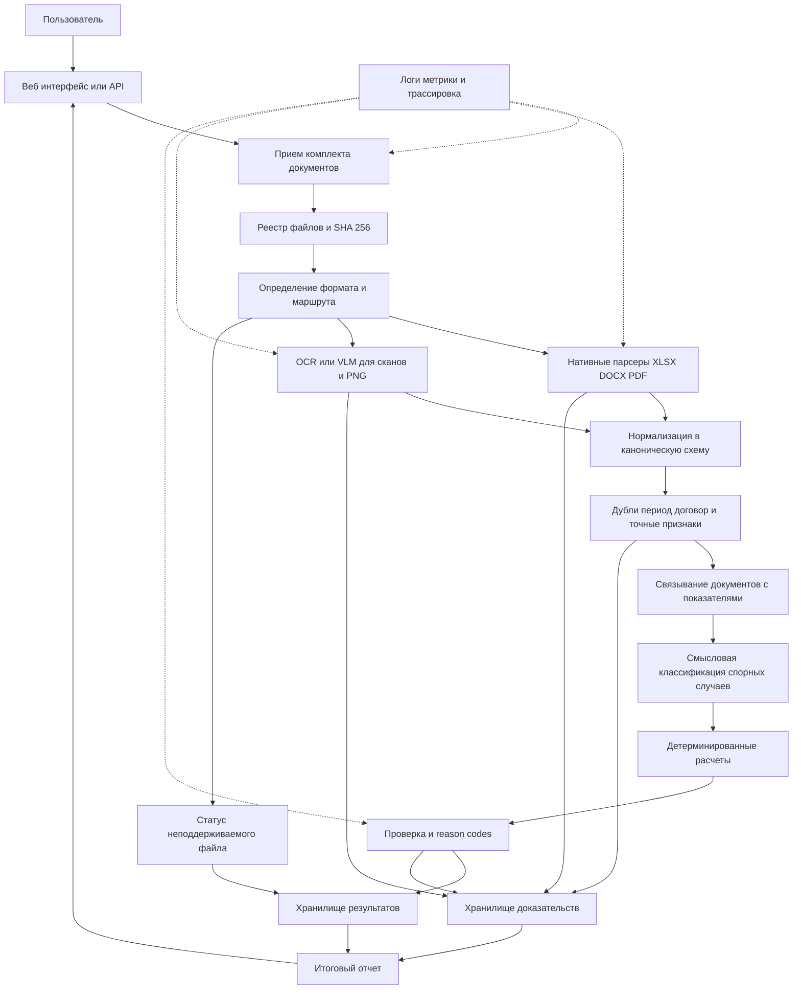

# Архитектура решения с учетом критериев жюри

## Назначение документа

Документ уточняет целевую архитектуру системы проверки финансовой отчетности с учетом официальных критериев хакатона. Базовый технический подход сохраняется: документы разбираются наиболее надежным для их формата способом, языковая модель решает только смысловые задачи, а финансовые вычисления выполняются детерминированно.

Основное изменение приоритетов: развертывание, демонстрационный интерфейс, трассируемость и обработка технических ошибок рассматриваются как обязательные части продукта, а не как завершающие улучшения.

Для Linux-контура отчета выбор уже подтвержден измерениями: PaddleOCR region-first при 300 DPI используется как основной путь, Tesseract full-page при 400 DPI — как независимый fallback. Оба движка локальные, а ожидаемые суммы не передаются production-экстрактору.

## Граница данных хакатона и production

После интервью с заказчиком обсуждалась необходимость ОСВ для контроля полноты
бухгалтерских документов. Организаторы подтвердили, что исходный набор является
окончательным и ОСВ в рамках хакатона предоставляться не будет. Поэтому обязательный
контур решения использует только КФЗ и выданные первичные или расчетные документы.

Отсутствие ОСВ:

- не является технической ошибкой;
- не является `MISSING_DOCUMENT` относительно хакатонного входного контракта;
- не препятствует подтверждению расхождений, которые полностью доказываются имеющимися
  документами;
- ограничивает только те показатели и утверждения о полноте, для которых в наборе нет
  самостоятельного доказательства.

В production архитектура может быть расширена трехсторонней сверкой
`КФЗ ↔ первичные документы ↔ ОСВ`, но это отдельная доработка вне текущего объема.

Отдельное согласие на текущий вертикальный срез получено. Дальнейшее расширение реализации выполняется только в согласованных пользователем границах.

## Архитектурное решение

### Что сохраняется

- нативный разбор XLSX, DOCX и PDF с текстовым слоем;
- OCR или документная VLM только для сканов и изображений;
- точные фильтры до нечеткого или семантического сопоставления;
- LLM для классификации назначения расходов и других смысловых случаев;
- детерминированная арифметика, правила округления и агрегирование;
- явный отказ от ответа при неоднозначности или недостатке данных;
- доказательство происхождения каждого итогового значения;
- отсутствие предобучения и fine-tuning на текущем этапе.

### Что добавляется как обязательный контур

- воспроизводимое контейнерное развертывание;
- полный пользовательский сценарий от загрузки до заключения;
- просмотр подтверждающего фрагмента документа;
- изоляция ошибки отдельного файла;
- аудит версий компонентов и правил;
- локальная обработка по умолчанию;
- наблюдаемость и понятные технические статусы;
- два воспроизводимых демонстрационных use case.

## Схема компонентов



## Пользовательский сценарий

Основной сценарий должен выполняться полностью:

1. Пользователь загружает итоговый отчет и комплект первичных документов.
2. Система показывает принятые файлы и индивидуальные ошибки приема.
3. Каждый файл обрабатывается независимо от остальных.
4. Система связывает первичные документы с показателями отчета.
5. Для каждого показателя рассчитывается ожидаемое значение.
6. Результаты разделяются на корректные, ошибочные, непроверенные и технически необработанные.
7. Пользователь открывает подтверждающий фрагмент исходного документа.
8. Система формирует общее заключение и сводку причин.
9. Результат можно повторно получить из того же входа и зафиксированных версий компонентов.

```text
Загрузка комплекта
        ↓
Статус обработки каждого файла
        ↓
Таблица проверяемых показателей
        ↓
Фактическое и ожидаемое значения
        ↓
Расхождение и категория причины
        ↓
Просмотр исходного доказательства
        ↓
Итоговое заключение
```

## Статусы результата

Статус показателя отделяется от технического состояния обработки файла.

### Финансовые и предметные статусы

| Статус | Значение |
|---|---|
| `CORRECT` | Показатель подтвержден и расхождение отсутствует |
| `MISMATCH` | Обнаружено подтвержденное расхождение |
| `INSUFFICIENT_DATA` | Данных недостаточно для достоверного вывода |
| `AMBIGUOUS` | Существует несколько допустимых связей или трактовок |
| `NOT_APPLICABLE` | Проверка неприменима к показателю |

### Технические статусы файла

| Статус | Значение |
|---|---|
| `PROCESSED` | Файл обработан полностью |
| `PARTIALLY_PROCESSED` | Получена только часть необходимых данных |
| `EXTRACTION_ERROR` | Извлечение завершилось ошибкой |
| `UNSUPPORTED_FORMAT` | Формат или структура не поддерживаются |
| `CORRUPTED_FILE` | Файл поврежден или не открывается |

Техническая ошибка файла не должна автоматически создавать финансовое расхождение. Если из-за нее нельзя проверить показатель, показатель получает `INSUFFICIENT_DATA`, а причина ссылается на технический статус источника.

## Коды причин

Статус отвечает на вопрос о результате проверки, а reason code объясняет причину.

| Код | Применение |
|---|---|
| `EXACT_MATCH` | Значение отчета точно совпадает с подтвержденным значением |
| `REPORT_OVERSTATED` | Значение отчета превышает подтвержденное значение |
| `REPORT_UNDERSTATED` | Значение отчета меньше подтвержденного значения |
| `DUPLICATE_DOCUMENT` | Документ уже учтен |
| `OUT_OF_PERIOD` | Документ относится к другому периоду |
| `WRONG_CONTRACT` | Документ относится к другому договору |
| `MISSING_DOCUMENT` | Ожидаемый документ отсутствует |
| `AMBIGUOUS_MATCH` | Нельзя однозначно выбрать источник |
| `INSUFFICIENT_DETAIL` | Нельзя проверить внутреннюю детализацию |
| `MISSING_DETAIL_SOURCE` | Для настроенной проверки детализации не найдено ни одного источника |
| `UNCLASSIFIED_OPERATIONS_PRESENT` | Есть операции в `REVIEW`, поэтому подтвержденная сумма является частичной |
| `SOURCE_DOCUMENT_PROCESSING_INCOMPLETE` | Один или несколько источников технически не обработаны; финансовый вывод по частичному комплекту запрещен |
| `REPORT_TOTAL_CONSISTENT` | Итоговая строка отчета равна сумме проверяемых статей |
| `REPORT_TOTAL_INCONSISTENT` | Итоговая строка отчета не равна сумме проверяемых статей |
| `EXTRACTION_FAILED` | Значение не удалось надежно извлечь |
| `UNSUPPORTED_DOCUMENT` | Документ не поддерживается текущей версией |

Отсутствующий источник никогда не интерпретируется как сумма `0.00`. В таком случае
`supported_value` и дельта остаются пустыми, а результат получает
`INSUFFICIENT_DATA / MISSING_DOCUMENT`. При наличии операций в `REVIEW` в итог входит
только подтвержденная классифицированная часть, она явно помечается как частичная и не
используется для вывода о финансовом расхождении.
Технический `REVIEW` дополнительно получает общую причину
`SOURCE_DOCUMENT_PROCESSING_INCOMPLETE`, чтобы отличать повреждение или сбой извлечения
от содержательно неоднозначной классификации.

## Трассируемость

Каждый результат должен содержать не только имя файла, но и конкретное доказательство.

| Тип источника | Минимальная ссылка |
|---|---|
| PDF или скан | Номер страницы и координаты области |
| PNG | Координаты области изображения |
| XLSX | Лист и адрес ячейки или диапазона |
| DOCX | Таблица и ячейка либо идентификатор абзаца |

Вместе с доказательством сохраняются:

- исходное и нормализованное значение;
- хеш документа;
- метод извлечения;
- версия парсера, OCR или модели;
- версия правила классификации и расчета;
- формула и входные значения;
- время обработки;
- статус ручного подтверждения.

Интерфейс должен позволять перейти от строки результата к фрагменту документа без ручного поиска по файлу.

## Изоляция ошибок

Единицей отказа является отдельный файл или отдельная операция, а не весь комплект.

Обязательное поведение:

- поврежденный файл получает собственный технический статус;
- остальные документы продолжают обрабатываться;
- повторный запуск не создает повторного учета документов;
- временная ошибка OCR или модели может быть повторена отдельно;
- частично извлеченные данные не выдаются за полный результат;
- итоговый отчет показывает влияние необработанного файла на проверяемость показателей;
- техническая ошибка и финансовое расхождение отображаются раздельно.

## Развертывание и воспроизводимость

Развертывание является частью основной архитектуры, поскольку составляет 20 из 100 технических баллов.

### Реализованные артефакты пакетного контура

- единый `Dockerfile` с локальными OCR-движками и моделями;
- `compose.yaml` с полным `pipeline` и отдельными диагностическими стадиями;
- настраиваемые `DATA_DIR`, `ARTIFACTS_DIR` и `CONFIG_DIR` без секретов;
- команда полного запуска `docker compose run --rm --build pipeline`;
- закрепленный digest базового образа и фиксированные Python-зависимости;
- read-only входные данные и отдельный writable-каталог артефактов;
- локальный runtime без внешних API и сетевых обращений;
- проверенные чистый прогон, повторный запуск с SHA-кэшем и сценарий поврежденного файла.

Healthcheck не применяется к завершаемому batch-процессу. Он потребуется при добавлении постоянно работающего HTTP API или очереди задач.

### Покрытие README

README должен содержать:

1. назначение и границы решения;
2. системные требования;
3. подготовку переменных окружения;
4. команды запуска и остановки;
5. описание входных и выходных данных;
6. перечень внешних сервисов;
7. архитектурную схему и поток данных;
8. два типовых use case;
9. известные ограничения;
10. порядок воспроизведения демонстрации.

## Политика внешних сервисов

Локальная обработка используется по умолчанию.

- Открытые данные могут обрабатываться внешним API после явного включения соответствующего режима.
- Конфиденциальные данные не передаются во внешние API.
- При использовании облачного компонента система должна явно показать, какие данные и куда передаются.
- Секреты хранятся вне исходного кода и не попадают в журналы.
- Должен существовать локальный сценарий демонстрации без обязательной передачи документов внешнему провайдеру.

## Демонстрационные сценарии

### Use case 1 Обнаружение финансового расхождения

**Вход:** итоговая КФЗ и валидные первичные документы комплекта кейса 19.

**Ожидаемое поведение:**

- система извлекает показатели строки `3 этап, 2026 г.`;
- рассчитывает ожидаемые суммы по статьям;
- подтверждает статьи 0200, 0300 и 0900;
- определяет ожидаемую сумму статьи 0800 как 1 133 298,10 руб.;
- находит завышение статьи 0800 на 12 500,00 руб.;
- рассчитывает общий ожидаемый итог 11 567 877,40 руб.;
- показывает источники каждого значения и формулу агрегирования;
- формирует итоговое заключение о недостоверности отчета из-за одного подтвержденного расхождения.

### Use case 2 Фильтрация и недостаток данных

**Вход:** полный комплект, содержащий дубль, документ вне периода, документ другого договора и источники с неполной внутренней детализацией.

**Ожидаемое поведение:**

- документы 09 и 10 распознаются как дубль и учитываются один раз;
- документ 14 исключается как `OUT_OF_PERIOD`;
- документ 15 исключается как `WRONG_CONTRACT`;
- валидные документы статьи 0900 дают итог 3 204 744,51 руб.;
- неподтвержденные внутренние подколонки получают `INSUFFICIENT_DATA` с причиной `INSUFFICIENT_DETAIL`;
- исключенные и неполные данные не создают ложных финансовых ошибок;
- пользователь может открыть доказательство для каждого решения.

## Соответствие критериям жюри

Количественная оценка компонентов и сквозного результата выполняется по документу [Метрики оценки решения](evaluation-metrics.md). Средние денежные отклонения не используются: каждое критическое значение проверяется отдельно и должно совпадать точно.

### Технические критерии

| Критерий | Максимум | Архитектурное покрытие |
|---|---:|---|
| Извлечение и связывание | 20 | Маршрутизация по формату, нативные парсеры, OCR/VLM, нормализация и связывание |
| Расчет и агрегирование | 16 | Детерминированный расчетный модуль, фильтры периода, единиц, знаков, округления и дублей |
| Выявление расхождений | 24 | Проверки, reason codes, контроль ложных ошибок и явная классификация проблем |
| Трассируемость и отчет | 12 | Хранилище доказательств, переход к фрагменту и разделение статусов |
| Неполные данные и надежность | 8 | Безопасный отказ от ответа, изоляция ошибок и технические статусы файлов |
| Развертывание и воспроизводимость | 20 | Docker, Compose, конфигурация, healthcheck, README и два use case |

### Отраслевые критерии

| Критерий | Максимум | Что должно быть показано на защите |
|---|---:|---|
| Полнота и применимость | 16 | Сквозной сценарий и рабочая демонстрация с возможностью загрузить комплект |
| Дополнительные идеи и развитие | 10 | Полезные возможности с доказанной ценностью и реалистичный план развития |
| Выступление | 4 | Короткий логичный рассказ: проблема, демонстрация, результат, ограничения и развитие |

## Приоритет реализации для максимума баллов

### P0 Обязательное ядро

1. Сквозная обработка комплекта кейса 19.
2. Точное обнаружение завышения на 12 500,00 руб.
3. Отсутствие ложных ошибок на корректных статьях.
4. Дубли, период, договор и недостаток данных.
5. Доказательство для каждого результата.
6. Итоговый отчет с раздельными статусами.
7. Docker-запуск в чистом окружении.
8. README и два воспроизводимых use case.

### P1 Усиление надежности

1. Поврежденные файлы и частичное извлечение.
2. Повторная обработка отдельного документа.
3. Метрики, логи и аудит версий.
4. Улучшение качества сканов.
5. Ручная проверка неоднозначных случаев.

### P2 Дополнительная ценность

1. Сравнение версий отчетов.
2. Экспорт заключения.
3. Настраиваемые правила без изменения кода.
4. Накопление пользовательских исправлений для будущего улучшения моделей.
5. Интеграции с учетными системами.

P2 не должен выполняться за счет незавершенных P0-сценариев.

## Критерии готовности архитектуры к реализации

Перед написанием кода необходимо согласовать:

- каноническую схему документов, показателей, доказательств и результатов;
- конечный список статусов и reason codes;
- основной локальный OCR/VLM-кандидат для PoC;
- формат итогового отчета и макет демонстрационного интерфейса;
- состав сервисов первого вертикального среза;
- правила хранения файлов и результатов;
- режим работы с открытыми и конфиденциальными данными;
- обязательные команды контейнерного запуска;
- критерии приемки двух демонстрационных сценариев.

После согласования этих пунктов можно переходить к декомпозиции P0 на задачи реализации.

Первый технический риск проверяется отдельно по спецификации [PoC распознавания целевой строки КФЗ](kfz-row-extraction-poc.md).
